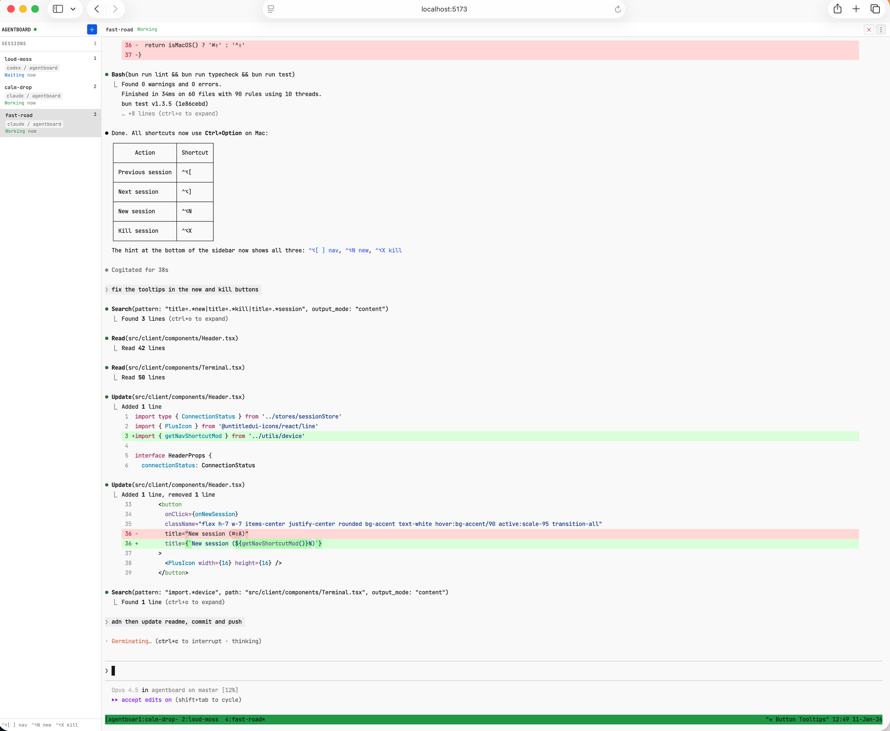
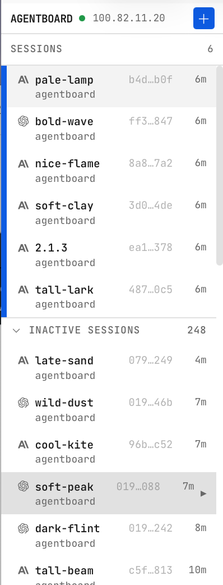
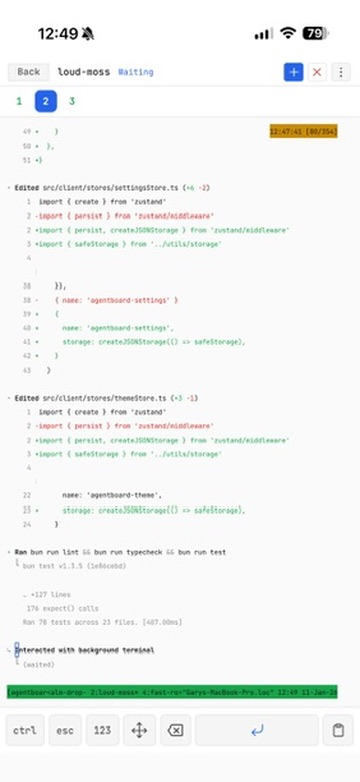
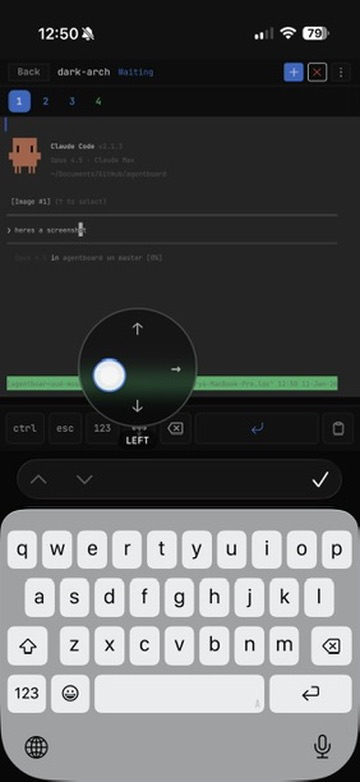

# Agentboard

[](https://github.com/gbasin/agentboard/actions)
[](https://www.npmjs.com/package/@gbasin/agentboard)
[](https://github.com/gbasin/agentboard/blob/master/LICENSE)
[](https://www.typescriptlang.org/)
[](https://deepwiki.com/gbasin/agentboard)

Agentboard is a web UI for `tmux`, built for running coding agents such as Claude Code and Codex. Start your agents on a desktop or server, then watch and steer them from any browser, including your phone.

Every session lives in tmux, so your agents keep running when you close the tab, and the same sessions are available from every device.

### Desktop
| Terminal | Sessions |
| :---: | :---: |
|  |  |

### Mobile
| Terminal | Controls |
| :---: | :---: |
|  |  |

## Features

**See what every agent is doing**

- Live status for each session: *working*, *waiting for input*, or *needs permission*.
- The last prompt you sent to each session, so you remember what it is working on.
- Pull requests that a session opened, with their state and CI checks.
- Subagent activity for Claude Code and Codex sessions.
- Optional sounds when a session needs permission or goes idle.

**Work in any session**

- A full terminal in the browser, with mouse scrolling, selection, and clipboard support for Claude Code's fullscreen renderer.
- Paste or drop text, images, and files into the prompt.
- A media rail that collects the images, documents, and links from a session's transcript.
- Keyboard shortcuts to switch, create, and close sessions.

**Use it from your phone**

- A touch layout for iOS Safari with a session drawer, a quick-keys toolbar (Esc, Tab, Ctrl, arrows, number pad), and a paste dialog.
- Touch scrolling, tap-to-click, and long-press selection in the terminal.
- Installs to the home screen as a PWA.

**Keep sessions organized**

- Sort by age or by what needs attention, filter by project or host, or drag sessions into your own order.
- **Hibernate** a session to close its tmux window and keep it in the sidebar. **Wake** it later to resume the conversation.
- **History** lists recent conversations. Open one to preview its transcript, then wake it.
- Session recovery reopens sessions after a crash or reboot. See [Session recovery](docs/session-recovery.md).
- Sessions from other machines appear on the same board over SSH. See [Remote hosts](docs/remote-hosts.md).

## Supported agents

| Agent | Matching, last prompt, Wake | Pull requests | Media rail | Subagent activity |
| --- | :---: | :---: | :---: | :---: |
| Claude Code | Yes | Yes | Yes | Yes |
| Codex | Yes | Yes | Yes | Yes |
| Pi | Yes | Yes | Links | |
| oh-my-pi | Yes | Yes | Links | |
| Devin CLI | Yes | Yes | Links | |
| Grok CLI | Yes | Yes | Links | |

The media rail shows images, documents, and links for Claude Code and Codex. For the other agents it shows links.

Agentboard finds each agent's transcripts in its default location and matches them to tmux windows automatically. Any other program that runs in tmux also works as a plain terminal session, with status but no transcript features.

## Requirements

- macOS (Apple Silicon or Intel) or Linux (x64 or arm64).
- tmux 3.2 or later: `brew install tmux` or `apt install tmux`.
- [ripgrep](https://github.com/BurntSushi/ripgrep) (`rg`): `brew install ripgrep` or `apt install ripgrep`. Agentboard uses it to match agent transcripts to tmux windows. The Homebrew and npm packages do not install it.
- [Tailscale](https://tailscale.com/download) (recommended) or another network path to your machine, for access from other devices.

Optional:

- The [GitHub CLI](https://cli.github.com/) (`gh`), signed in, to show pull request state and CI checks.
- `ssh` with key-based access, to show sessions from [remote hosts](docs/remote-hosts.md).

## Install

### Homebrew

```bash
brew tap gbasin/tap
brew install agentboard
agentboard
```

### npm

Requires Node.js 18 or later.

```bash
npm install -g @gbasin/agentboard
agentboard
```

Or run it without installing:

```bash
npx @gbasin/agentboard
```

Then open `http://localhost:4040`.

### Open it from another device

If Tailscale is running, Agentboard also listens on your Tailscale address. Open `http://<your-machine>:4040` from any device on your tailnet. To install the board on your phone's home screen, see [PWA installation](docs/pwa-install.md).

Without Tailscale, Agentboard accepts connections from the same machine only. To change that, see [Network and security](docs/configuration.md#network-and-security).

### Run it as a service

To start Agentboard at login and keep it running:

- macOS: [launchd/README.md](launchd/README.md)
- Linux: [systemd/README.md](systemd/README.md)

Both installers run from a git checkout of this repository, not from a Homebrew or npm install. The launchd release installer downloads its own copy of Agentboard from npm into `~/.agentboard/releases/`. The launchd source installer and the systemd installer run the checkout with Bun.

### Upgrade

Run `brew upgrade agentboard` or `npm install -g @gbasin/agentboard@latest`, then restart Agentboard. Your tmux sessions keep running across the restart, and your data stays in `~/.agentboard`.

These commands do not upgrade a service installed with the launchd or systemd installer. Upgrade a service as its guide describes.

### Uninstall

1. Stop Agentboard. If you installed a service, remove it first: see the uninstall section of [launchd/README.md](launchd/README.md#uninstall) or [systemd/README.md](systemd/README.md#uninstall).
2. Remove the package.
   - Homebrew: `brew uninstall agentboard`. To also remove the tap, run `brew untap gbasin/tap`.
   - npm: `npm uninstall -g @gbasin/agentboard`.

Uninstalling leaves these in place:

- `~/.agentboard`, which holds the database, the log, and other data. To delete it, run `rm -rf ~/.agentboard`.
- Your tmux sessions and the programs in them. They keep running.
- Files uploaded through the board, in `/tmp` and in the system temporary directory.

### From source

See [Development](docs/development.md).

## Configuration

Agentboard is configured with environment variables. It has no command-line flags.

```bash
PORT=8080 TMUX_SESSION=work agentboard
```

| Variable | Default | Effect |
| --- | --- | --- |
| `PORT` | `4040` | Port for the web UI. |
| `HOSTNAME` | `127.0.0.1` | Address to bind. Set `0.0.0.0` to listen on all interfaces. |
| `TMUX_SESSION` | `agentboard` | Name of the tmux session that Agentboard manages. |
| `DISCOVER_PREFIXES` | unset | Limits which of your other tmux sessions appear on the board. By default, all of them appear. |
| `AGENTBOARD_REMOTE_HOSTS` | unset | SSH hosts to show on the board. |
| `AGENTBOARD_DATA_DIR` | `~/.agentboard` | Directory for the database and logs. |

See [Configuration](docs/configuration.md) for every setting.

Appearance, notification sounds, command presets, session list options, and terminal options are in the **Settings** dialog in the UI.

> **Security note:** Agentboard has no built-in authentication. Anyone who can reach the server has full access to your terminal sessions, including the ability to run commands as your user. The default localhost binding is safe. Tailscale provides network-level auth for remote access. Avoid setting `HOSTNAME=0.0.0.0` on untrusted networks (public WiFi, shared LANs) without an additional access control layer.

## Keyboard shortcuts

| Action | Mac | Windows/Linux |
|--------|-----|---------------|
| Previous session | `Ctrl+Option+[` | `Ctrl+Shift+[` |
| Next session | `Ctrl+Option+]` | `Ctrl+Shift+]` |
| Jump to session 1-9 | `Ctrl+Option+1..9` | `Ctrl+Shift+1..9` |
| New session | `Ctrl+Option+N` | `Ctrl+Shift+N` |
| Kill session | `Ctrl+Option+X` | `Ctrl+Shift+X` |
| Settings | `Ctrl+Option+,` | `Ctrl+Shift+,` |

To use a different modifier, open **Settings** > **Terminal**.

## How it works

```
┌─────────────┐    SSH     ┌─────────────┐
│ Remote Host ├───────────►│             │   WebSocket   ┌────────────┐
│ (tmux)      │            │  Agentboard ├──────────────►│  Browser   │
└─────────────┘    tmux    │  Server     │               │  (React +  │
┌─────────────┐    CLI     │             │               │  xterm.js) │
│ Local tmux  ├───────────►│  - discover │               └────────────┘
│ sessions    │            │    sessions │
└─────────────┘            │  - parse    │
┌─────────────┐    read    │    agent    │
│ Agent logs  ├───────────►│    logs     │
│             │            └─────────────┘
└─────────────┘
```

- **Session discovery** — polls local tmux windows and (optionally) remote hosts over SSH.
- **Status inference** — reads pane content to determine if each agent is *working*, *waiting for input*, or *asking for permission*.
- **Log matching** — reads agent transcripts to match each session to its tmux window and to show its last prompt, pull requests, and media.
- **Live terminal** — streams I/O through the server so you can interact with any session from any device.
- **Hibernating and History sessions** — keeps dormant agent sessions in the sidebar and wakes them on demand. Startup does not wake hibernating or History sessions.

## Documentation

- [Configuration](docs/configuration.md): every environment variable.
- [Remote hosts](docs/remote-hosts.md): sessions from other machines over SSH.
- [Session recovery](docs/session-recovery.md): reopen sessions after a crash or reboot.
- [PWA installation](docs/pwa-install.md): add the board to your phone's home screen.
- [macOS service](launchd/README.md) and [Linux service](systemd/README.md).
- [Development](docs/development.md): run from source and contribute.
- [Security policy](SECURITY.md).
