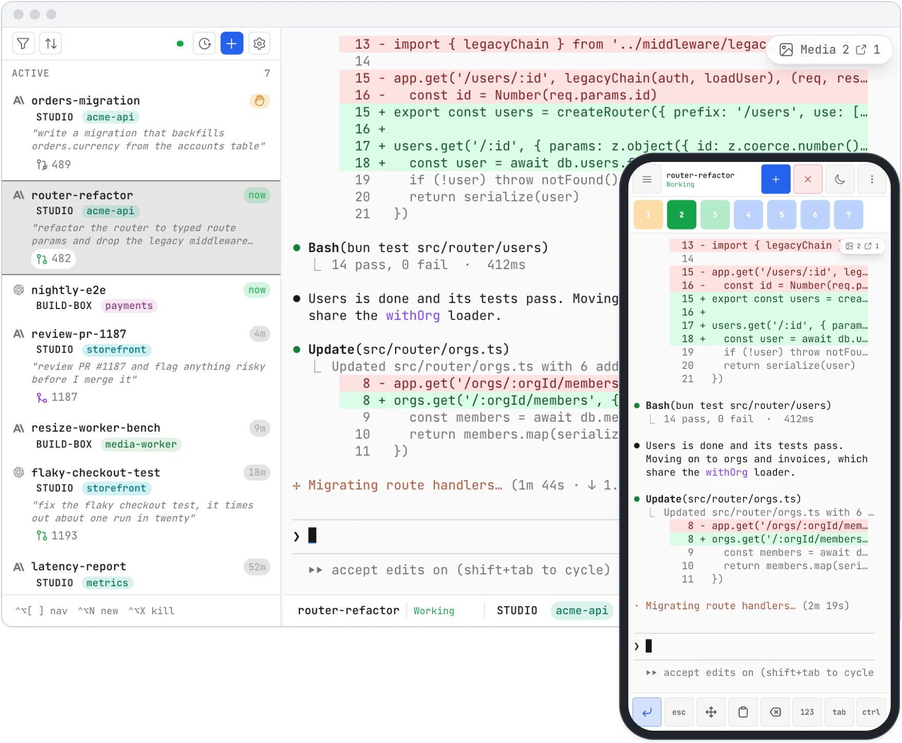
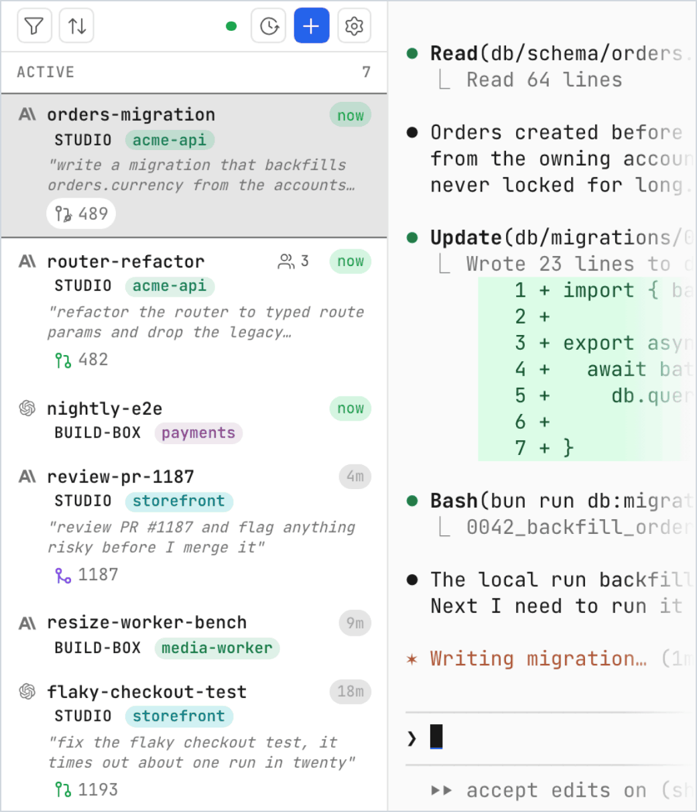
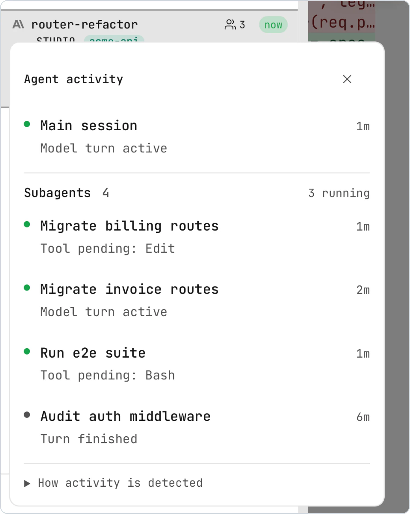
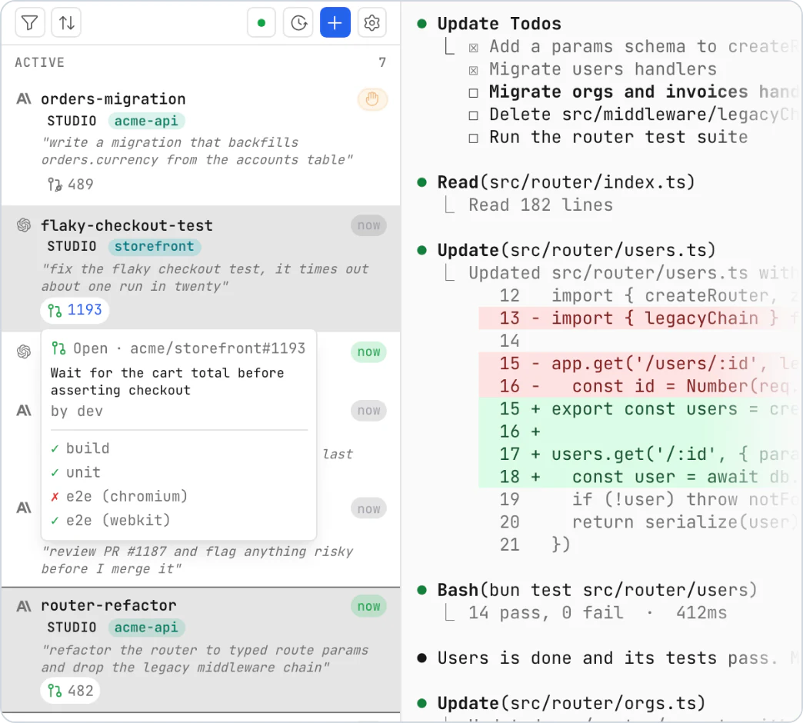
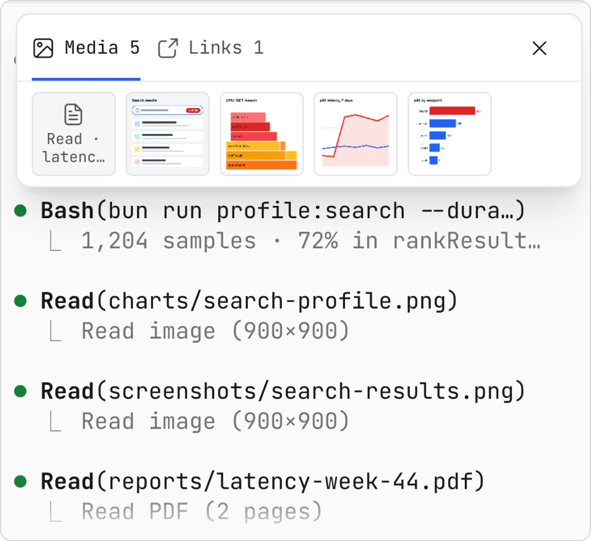
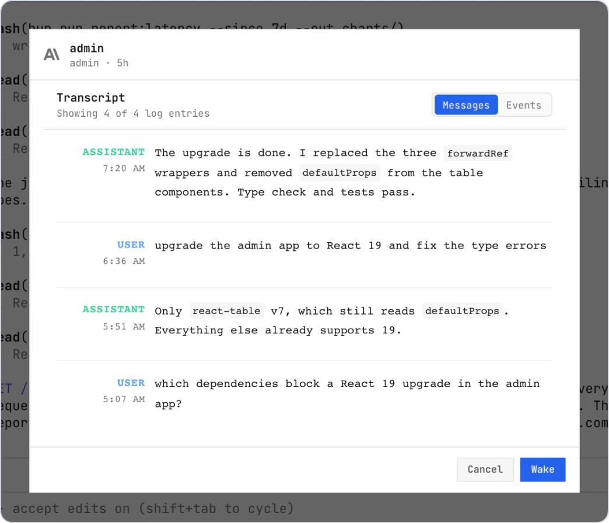
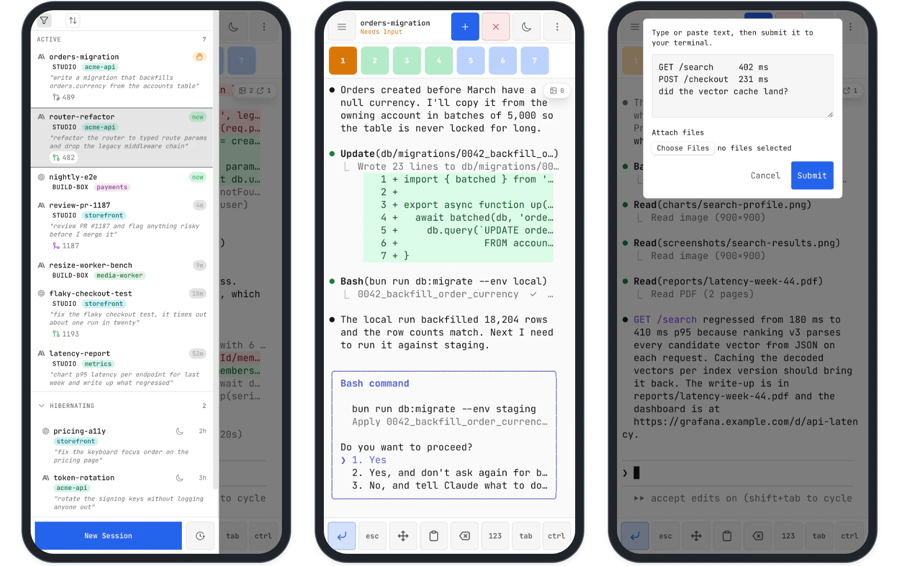
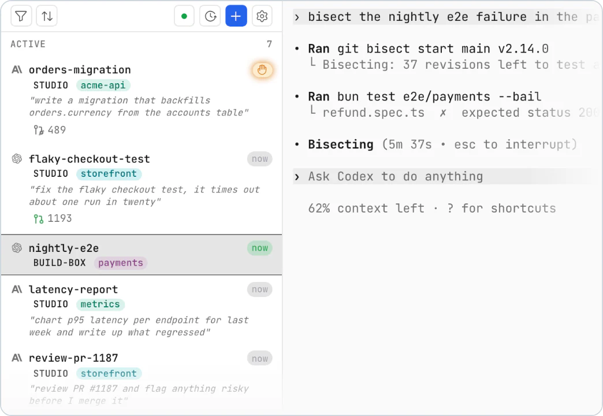

# Agentboard

[](https://github.com/gbasin/agentboard/actions)
[](https://www.npmjs.com/package/@gbasin/agentboard)
[](https://github.com/gbasin/agentboard/blob/master/LICENSE)
[](https://www.typescriptlang.org/)
[](https://deepwiki.com/gbasin/agentboard)

Agentboard is a web UI for `tmux`, built for running coding agents such as Claude Code and Codex. Start your agents on a desktop or server, then watch and steer them from any browser, including your phone.

Every session lives in tmux, so your agents keep running when you close the tab, and the same sessions are available from every device.

<p align="center">
  
</p>
<p align="center"><sub>The same tmux sessions on a laptop and a phone.</sub></p>

## Features

<table>
<tr>
<td width="40%" valign="top">

### Status and last prompt for every session

Each session shows a status inferred from its terminal output: *working*, *waiting for input*, or *needs permission*. Sessions matched to an agent transcript also show the last prompt you sent. Optional sounds tell you when a session needs permission or goes idle.

</td>
<td width="60%">

</td>
</tr>
<tr>
<td width="40%" valign="top">

### Subagent activity

For local Claude Code and Codex sessions, a counter on the session shows how many subagents are running. Click it to see the main session and each subagent with its current state and the time of its last activity signal.

</td>
<td width="60%">

</td>
</tr>
<tr>
<td width="40%" valign="top">

### Pull requests with CI state

Pull requests that a session created with `gh pr create` appear as chips on the session, colored by state: open, draft, merged, or closed. Claude Code sessions also show pull requests that Claude Code linked to the session, such as one it pushed to. Hover a chip to see its title and CI checks.

</td>
<td width="60%">

</td>
</tr>
<tr>
<td width="40%" valign="top">

### Media from the transcript

A media rail collects the images, documents, and links from a session's transcript. Open any image in a viewer and step through the rest.

</td>
<td width="60%">

</td>
</tr>
<tr>
<td width="40%" valign="top">

### History, Hibernate, and Wake

**Hibernate** closes an agent session's tmux window and keeps its conversation in the sidebar. It works for local sessions in the tmux session that Agentboard manages. **History** lists recent conversations: open one to preview its transcript, then **Wake** it to resume.

</td>
<td width="60%">

</td>
</tr>
<tr>
<td colspan="2">

### On your phone

On a small screen the board switches to a touch layout: a session drawer, a quick-keys toolbar (Esc, Tab, Ctrl, arrow keys, numbers), and a paste dialog. Touch scrolling, tap-to-click, and long-press selection work in the terminal. Add the board to your home screen as a PWA.



</td>
</tr>
<tr>
<td width="40%" valign="top">

### Sessions from other machines

Sessions from other machines appear on the same board over SSH, with a host badge on each one. Filter the board by host or by project. See [Remote hosts](docs/remote-hosts.md).

</td>
<td width="60%">

</td>
</tr>
</table>

### Also

- A full terminal in the browser. Mouse scrolling, selection, and the clipboard work with Claude Code's fullscreen renderer.
- Paste or drop text, images, and files into the prompt.
- Keyboard shortcuts to switch, create, and close sessions.
- Sort by age or by what needs attention, filter by project or host, or drag sessions into your own order.
- Session recovery lists the sessions that a crash or reboot interrupted, so you can reopen them. Automatic reopening is opt-in. See [Session recovery](docs/session-recovery.md).

## Supported agents

| Agent | Matching, last prompt, Wake | Pull requests | Media rail | Subagent activity |
| --- | :---: | :---: | :---: | :---: |
| Claude Code | Yes | Yes | Yes | Yes |
| Codex | Yes | Yes | Yes | Yes |
| Pi | Yes | Yes | Links | |
| oh-my-pi | Yes | Yes | Links | |
| Devin CLI | Yes | Yes | Links | |
| Grok CLI | Yes | Yes | Links | |

The media rail shows images, documents, and links for Claude Code and Codex. For the other agents it shows links.

Agentboard finds each agent's transcripts in its default location and matches them to tmux windows automatically. Any other program that runs in tmux also works as a plain terminal session, with status but no transcript features.

## Requirements

- macOS (Apple Silicon or Intel) or Linux (x64 or arm64).
- tmux 3.2 or later: `brew install tmux` or `apt install tmux`.
- [ripgrep](https://github.com/BurntSushi/ripgrep) (`rg`): `brew install ripgrep` or `apt install ripgrep`. Agentboard uses it to match agent transcripts to tmux windows. The Homebrew and npm packages do not install it.
- [Tailscale](https://tailscale.com/download) (recommended) or another network path to your machine, for access from other devices.

Optional:

- The [GitHub CLI](https://cli.github.com/) (`gh`), signed in, to show pull request state and CI checks.
- `ssh` with key-based access, to show sessions from [remote hosts](docs/remote-hosts.md).

## Install

### Homebrew

```bash
brew tap gbasin/tap
brew install agentboard
agentboard
```

### npm

Requires Node.js 18 or later.

```bash
npm install -g @gbasin/agentboard
agentboard
```

Or run it without installing:

```bash
npx @gbasin/agentboard
```

### Open the board

Open `http://localhost:4040` on the same machine.

If Tailscale is running, Agentboard also listens on your Tailscale address. Open `http://<your-machine>:4040` from any device on your tailnet. To install the board on your phone's home screen, see [PWA installation](docs/pwa-install.md).

Without Tailscale, Agentboard accepts connections from the same machine only. To change that, see [Network and security](docs/configuration.md#network-and-security).

### Run it as a service

To start Agentboard at login and keep it running:

- macOS: [launchd/README.md](launchd/README.md)
- Linux: [systemd/README.md](systemd/README.md)

### Upgrade

Run `brew upgrade agentboard` or `npm install -g @gbasin/agentboard@latest`, then restart Agentboard. Your tmux sessions keep running across the restart, and your data stays in `~/.agentboard`.

### From source

See [Development](docs/development.md).

## Configuration

Agentboard is configured with environment variables. It has no command-line flags.

```bash
PORT=8080 TMUX_SESSION=work agentboard
```

| Variable | Default | Effect |
| --- | --- | --- |
| `PORT` | `4040` | Port for the web UI. |
| `HOSTNAME` | `127.0.0.1` | Address to bind. Set `0.0.0.0` to listen on all interfaces. |
| `TMUX_SESSION` | `agentboard` | Name of the tmux session that Agentboard manages. |
| `DISCOVER_PREFIXES` | unset | Limits which of your other tmux sessions appear on the board. By default, all of them appear. |
| `AGENTBOARD_REMOTE_HOSTS` | unset | SSH hosts to show on the board. |
| `AGENTBOARD_DATA_DIR` | `~/.agentboard` | Directory for the database and logs. |

See [Configuration](docs/configuration.md) for every setting.

Appearance, notification sounds, command presets, session list options, and terminal options are in the **Settings** dialog in the UI.

> **Security note:** Agentboard has no built-in authentication. Anyone who can reach the server has full access to your terminal sessions, including the ability to run commands as your user. The default localhost binding is safe. Tailscale provides network-level auth for remote access. Avoid setting `HOSTNAME=0.0.0.0` on untrusted networks (public WiFi, shared LANs) without an additional access control layer.

## Keyboard shortcuts

| Action | Mac | Windows/Linux |
|--------|-----|---------------|
| Previous session | `Ctrl+Option+[` | `Ctrl+Shift+[` |
| Next session | `Ctrl+Option+]` | `Ctrl+Shift+]` |
| Jump to session 1-9 | `Ctrl+Option+1..9` | `Ctrl+Shift+1..9` |
| New session | `Ctrl+Option+N` | `Ctrl+Shift+N` |
| Kill session | `Ctrl+Option+X` | `Ctrl+Shift+X` |
| Settings | `Ctrl+Option+,` | `Ctrl+Shift+,` |

To use a different modifier, open **Settings** > **Terminal**.

## How it works

```
┌─────────────┐    SSH     ┌─────────────┐
│ Remote Host ├───────────►│             │   WebSocket   ┌────────────┐
│ (tmux)      │            │  Agentboard ├──────────────►│  Browser   │
└─────────────┘    tmux    │  Server     │               │  (React +  │
┌─────────────┐    CLI     │             │               │  xterm.js) │
│ Local tmux  ├───────────►│  - discover │               └────────────┘
│ sessions    │            │    sessions │
└─────────────┘            │  - parse    │
┌─────────────┐    read    │    agent    │
│ Agent logs  ├───────────►│    logs     │
│             │            └─────────────┘
└─────────────┘
```

- **Session discovery:** The server polls local tmux windows and, if you configure them, remote hosts over SSH.
- **Status inference:** The server reads pane content to tell if each agent is *working*, *waiting for input*, or *asking for permission*.
- **Log matching:** The server reads agent transcripts to match each session to its tmux window and to show its last prompt, pull requests, and media.
- **Live terminal:** The server streams terminal I/O to the browser, so you can use any session from any device.
- **Hibernating and History sessions:** The sidebar keeps dormant agent sessions, and you wake one when you need it. Startup does not wake hibernating or History sessions.

## Documentation

- [Configuration](docs/configuration.md): every environment variable.
- [Remote hosts](docs/remote-hosts.md): sessions from other machines over SSH.
- [Session recovery](docs/session-recovery.md): reopen sessions after a crash or reboot.
- [PWA installation](docs/pwa-install.md): add the board to your phone's home screen.
- [macOS service](launchd/README.md) and [Linux service](systemd/README.md).
- [Development](docs/development.md): run from source and contribute.
- [Security policy](SECURITY.md).
