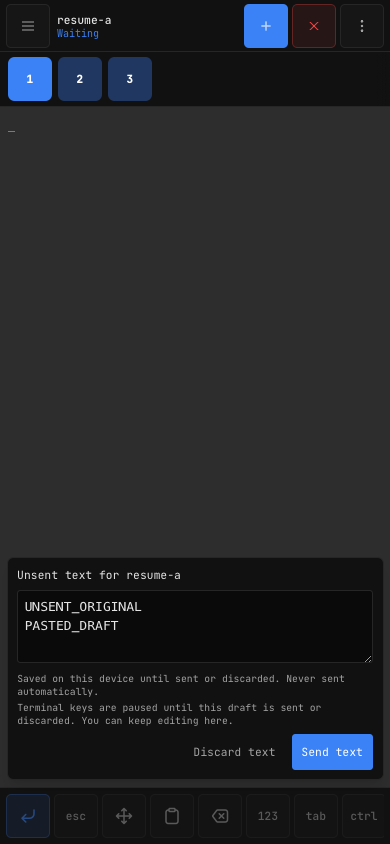

# Independent review disposition

Claude reviewed implementation `0d778dc` read-only through the consult-claude
skill (job `20261024-165107-claude-8214a7b2`). It found no blocking fencing,
lease ownership, overflow, or persistence defect in the sequences it traced,
but identified an availability regression in retirement's five-second deadline.
This is an advisory review, not independent execution of the test suite.

## Slow observer disposal

Verified: retirement emitted `fatal` after five seconds; the parent exits on
that message. Disposal waits for size mutations and tmux cleanup, whose own
timeouts can exceed five seconds. One retiring observer could exit the service.

State trace before the correction:

| Event | Relay | Retiring worker | Healthy sibling |
| --- | --- | --- | --- |
| Close legacy connection | leases=1, retiring=1 | shutdown requested | active |
| tmux cleanup stalls | leases=1, retiring=1 | waiting for cleanup | active |
| Five-second deadline | fatal sent to parent | still waiting | disconnected by process exit |

After the correction, the deadline emits a warning. State remains
`leases=1, retiring=1, idle=0`; the healthy sibling continues receiving output.
Thirty further leases fill capacity, so another request is rejected. A late
`stopped` acknowledgment moves the retired worker into the idle pool and removes
the retirement task. The next attachment reuses that worker; the realm count
stays at 32. No worker is terminated or reused before acknowledgment. Explicit
server shutdown retains its separate outer deadline. A permanently stuck
retirement therefore costs one slot until restart, rather than exiting healthy
connections.

Regression coverage waits beyond the actual five-second deadline, checks no
fatal notification, checks sibling output, fills capacity, then verifies reuse
only after acknowledgment. The focused lease suite passes (11 tests).

## Pending draft controls

Verified: toolbar controls appeared enabled after reconnect but control bytes
were discarded by draft capture. Keep routing unambiguous: disable terminal
controls while a draft is open, retain keyboard/editor access, and explain that
Send or Discard restores terminal keys. Do not silently send control commands
while ordinary typing is local. The user asked for our recommendation on this
choice; this follows the existing explicit-review behavior.

Chromium and WebKit pass the four focused recovery/persistence E2E cases after
this change. Tests assert disabled Esc/Enter with a live terminal and draft,
explicit submission, no automatic submission, reload restoration, and discard.
Component tests also assert keyboard access and control restoration after Send.

## Caveats and follow-ups

- Claude described a phone draft interrupting desktop typing. That is incorrect
  across devices: localStorage is local to the browser storage container. Sibling
  tabs in the same container do share drafts and can pause each other's input.
- Capacity eviction waits for disposal acknowledgment; rejecting the current
  request is intentional to preserve the bound. Dashboard-only leases still
  count against the 32-lease limit, although they allocate no terminal worker.
- Catalog identity sorting on status broadcasts is a reasonable future
  optimization; it does not block the isolated terminal relay.
- Successful WebSocket send is not a server execution acknowledgment. This
  remains documented. No retry or automatic draft submission was added.
- Uncaught worker failures retain the existing fatal policy. This correction
  handles slow retirement, not arbitrary worker crashes.

The first Linux CI run also exposed a test that assumed Cmd+V on every host.
The corrected fixture explicitly covers macOS, Linux, and Windows shortcuts;
Linux CI passed on that correction before these review follow-ups.
